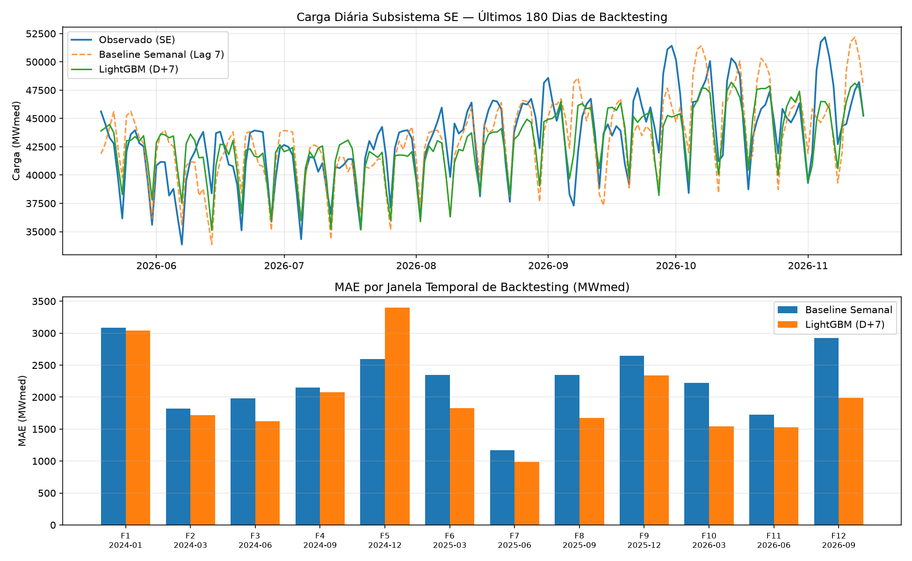
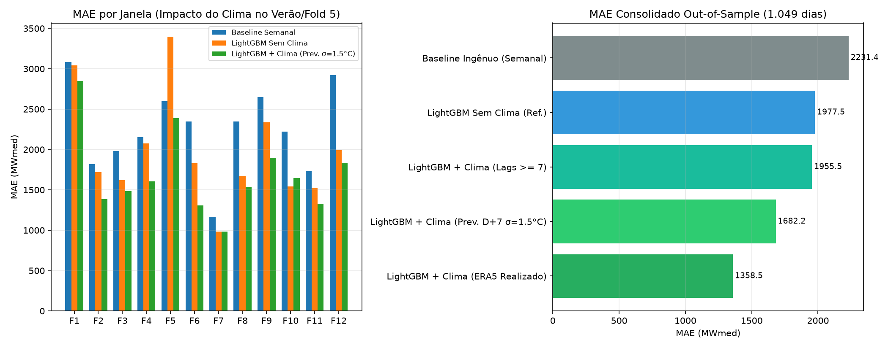

# Previsão de Carga de Energia Diária (ONS) - Subsistema Sudeste/Centro-Oeste

Projeto de previsão de carga diária de energia elétrica para o subsistema Sudeste/Centro-Oeste (`SE`) do Sistema Interligado Nacional (SIN), com horizonte de 7 dias à frente, utilizando dados abertos do Operador Nacional do Sistema Elétrico (ONS).

---

## ⚡ Pergunta do Desafio

> **O seu modelo prevê melhor do que simplesmente repetir o valor do mesmo dia da semana anterior? Se sim, quanto melhor?**

**Sim.** No backtesting temporal *walk-forward* de 12 janelas (1.049 dias entre 01/01/2024 e 14/11/2026), o modelo **LightGBM** superou o baseline semanal em **11 de 12 janelas**, reduzindo o **MAE de 2.231,37 para 1.977,50 MWmed (-253,86 MWmed / +11,38% de ganho)** e o **MAPE de 5,03% para 4,39% (+12,67% de ganho)**. O único período em que o baseline venceu foi o verão de 2025 (Fold 5), evidenciando o impacto de ondas de calor atípicas na ausência de variável climática exógena.

---

## 🏛️ Arquitetura da Solução

O projeto segue a arquitetura em medalhão (Bronze, Silver, Gold) com engenharia de atributos sem vazamento temporal (*leakage*), baseline, modelo de Machine Learning monitorado no MLflow e backtesting *walk-forward*:

```
├── data/
│   └── bronze/               # Parquets brutos do ONS (2018 até o presente)
├── dbt_project/              # Projeto dbt-duckdb para camadas Silver (02_) e Gold (03_)
│   ├── models/
│   │   ├── silver/           # 02_silver_carga_energia.sql (tipagem e deduplicação)
│   │   └── gold/             # 03_gold_carga_energia_se.sql (série contínua SE + testes)
│   └── dbt_project.yml
├── src/
│   ├── ingestion/            # 01_bronze_*: download e validação da camada Bronze
│   ├── transformation/       # 02_silver_gold_dbt.py (orquestrador dbt run/test)
│   ├── features/             # 05_feature_engineering.py (lags >= 7, feriados, calendário)
│   ├── models/               # 04_baseline_semanal.py e 05_train_lightgbm.py + MLflow
│   └── evaluation/           # 06_backtest.py (walk-forward validation em MAE e MAPE)
├── reports/                  # Tabelas e gráfico comparativo gerados pelo backtesting
├── tests/                    # Testes automatizados por etapa (01_ a 06_)
├── pyproject.toml            # Gerenciamento de dependências
├── .gitignore                # Arquivos ignorados pelo Git
└── README.md                 # Documentação do projeto
```

### Convenção de Nomenclatura por Camada
- `00_*`: Ambiente e configuração inicial
- `01_*`: Camada **Bronze** (ingestão, extração e validação de dados brutos)
- `02_*`: Camada **Silver** (limpeza, tipagem e padronização no dbt)
- `03_*`: Camada **Gold** (agregação e série diária final do subsistema `SE`)
- `04_*` a `06_*`: Baseline, Modelagem LightGBM + MLflow e Backtesting Temporal

---

## 📋 Etapas do Projeto

1. **Etapa 1 - Ambiente**: Repositório, dependências com `pyproject.toml`, `.gitignore` e documentação inicial.
2. **Etapa 2 - Ingestão (Bronze)**: Download direto dos arquivos Parquet de 2018 até hoje do bucket público ONS S3 (`s3://ons-aws-prod-opendata/dataset/carga_energia_di/`), preservando os dados brutos.
3. **Etapa 3 - Transformação (Silver e Gold)**: Transformações analíticas com `dbt` e `DuckDB`:
   - Silver (`02_silver_*`): padronização de tipos (`DATETIME` -> `DATE`, `VARCHAR` -> `DOUBLE`).
   - Gold (`03_gold_*`): subsistema Sudeste/Centro-Oeste (`id_subsistema = 'SE'`) com 14 testes dbt passando.
4. **Etapa 4 - Baseline**: Previsão ingênua semanal ($y_{t+7} = y_t$, lag de 7 dias).
5. **Etapa 5 - Modelo Preditivo**: LightGBM com features de calendário, feriados nacionais (`holidays`), regime ONS e lags válidos ($\ge 7$), registrado no **MLflow**.
6. **Etapa 6 - Avaliação e Backtesting**: Validação temporal expansiva (*walk-forward*, 12 janelas de 90 dias), comparando modelo vs. baseline via **MAE** e **MAPE**.

---

## 🔍 Nuances Metodológicas dos Dados do ONS

Conforme documentado no histórico de evolução da medição de carga do ONS:
- **Até fev/2021**: Carga atendida por usinas despachadas/programadas pelo ONS.
- **Mar/2021 a abr/2023**: Carga despachada + previsão de geração de usinas não despachadas.
- **A partir de 29/04/2023**: Incorporação da estimativa de micro e minigeração distribuída (MMGD).

Essas transições metodológicas são explicitadas na camada Gold (`regime_medicao_ons`) e usadas como feature no modelo.

---

## 🚀 Como Executar

### Pré-requisitos
- Python >= 3.11
- `uv` ou `pip`

### 1. Instalação do Ambiente
```bash
uv venv
source .venv/bin/activate
uv pip install -e ".[dev]"
```

### 2. Ingestão e Validação da Camada Bronze (`01_`)
```bash
python src/ingestion/01_bronze_download.py
python src/ingestion/01_bronze_validate.py
pytest tests/01_bronze_test.py
```

### 3. Transformação com dbt (Silver `02_` e Gold `03_`)
```bash
python src/transformation/02_silver_gold_dbt.py
pytest tests/02_silver_test.py tests/03_gold_test.py
```

### 4. Baseline Ingênuo Semanal (`04_`)
```bash
python src/models/04_baseline_semanal.py
pytest tests/04_baseline_test.py
```

### 5. Treinamento LightGBM + MLflow (`05_`)
```bash
python src/models/05_train_lightgbm.py
pytest tests/05_model_test.py
```

### 6. Backtesting Temporal (`06_`) e Visualização no MLflow
```bash
python src/evaluation/06_backtest.py
pytest tests/06_backtest_test.py
mlflow ui --backend-store-uri sqlite:///mlflow.db
```

### 7. Bônus: Temperatura como Variável Exógena (`07_`)
```bash
python src/ingestion/01_bronze_weather.py
python src/transformation/02_silver_gold_dbt.py
python src/evaluation/07_backtest_clima.py
pytest tests/07_weather_test.py
```

---

## 📈 Resultados do Backtesting

> **Referência histórica do Baseline Ingênuo Semanal (2018–2026, $n=3.233$ dias)**: MAE = **1.976,47 MWmed** | MAPE = **4,90%**.  
> **Backtesting Walk-Forward (01/01/2024 a 14/11/2026, 1.049 dias em 12 janelas de 90 dias)**:

| Modelo | MAE (MWmed) | MAPE (%) | RMSE (MWmed) | Janelas Vencidas | Ganho sobre Baseline (MAE / MAPE) |
| :--- | :---: | :---: | :---: | :---: | :---: |
| **Baseline Ingênuo (Semanal)** | 2.231,37 | 5,03% | 2.899,99 | 1 / 12 | 0,0% (Ref.) |
| **LightGBM (Horizonte D+7)** | **1.977,50** | **4,39%** | **2.583,58** | **11 / 12** | **+11,38% / +12,67%** |



---

## 🌡️ Bônus: Impacto da Temperatura como Variável Exógena

Enriquecemos o modelo com temperatura diária ponderada das 4 principais capitais consumidoras do subsistema SE/CO (SP 50%, RJ 25%, BH 15%, DF 10%) via **Open-Meteo ERA5 Reanalysis** (escolhida como alternativa sem falhas após o endpoint público do INMET retornar HTTP 503/404 sem token e os ZIPs anuais somarem ~850 MB com defasagem no mês corrente).

Para garantir avaliação honesta sem vazamento, testamos separadamente:
1. **Apenas lags climáticos $\ge 7$ dias** (zero previsão futura).
2. **Previsão meteorológica D+7 realista** (adicionando erro gaussiano $\sigma = 1{,}5^\circ\text{C}$ no teste).
3. **ERA5 realizado** (teto teórico com previsão climática perfeita).

| Cenário (12 Janelas, 1.049 dias) | MAE (MWmed) | MAPE (%) | Janelas Vencidas | MAE Fold 5 (Verão 2025) | Ganho MAE vs Baseline |
| :--- | :---: | :---: | :---: | :---: | :---: |
| **Baseline Ingênuo (Semanal)** | 2.231,37 | 5,03% | - | 2.598,04 | 0,00% |
| **LightGBM Sem Clima (Ref.)** | 1.977,50 | 4,39% | 11 / 12 | 3.397,00 | +11,38% |
| **LightGBM + Clima (Lags $\ge 7$)** | 1.955,49 | 4,34% | 10 / 12 | 3.525,13 | +12,36% |
| **LightGBM + Clima (Prev. D+7 $\sigma=1{,}5^\circ\text{C}$)** | **1.682,21** | **3,74%** | **12 / 12** | **2.388,52** | **+24,61%** |
| **LightGBM + Clima (ERA5 Realizado)** | 1.358,51 | 3,01% | 12 / 12 | 2.285,42 | +39,12% |



> **Conclusão do Bônus**: Com previsão meteorológica D+7 realista ($\sigma = 1{,}5^\circ\text{C}$), o ganho sobre o baseline mais que **dobra** (de **+11,38%** para **+24,61%**), vencendo **12 de 12 janelas** e revertendo a derrota do **Fold 5 (verão 2025)** de 3.397,00 para 2.388,52 MWmed.

---

## 🔮 O Que Eu Faria Com Mais Tempo (Próximos Passos)
- **Integração operacional com previsão D+7 (Open-Meteo Forecast / CPTEC-INPE)**: Consumir previsões reais salvas diariamente (*vintage forecasts*) em vez de erro simulado.
- **Ablação do `lag_364` e ajuste de janela de treino**: Avaliar se substituir `lag_364` por médias sazonais recupera os dados de 2018 e melhora a adaptação ao regime MMGD recente.
- **Segundo concorrente estatístico (`statsforecast`)**: Comparar AutoETS/AutoARIMA contra o LightGBM.
- **Modelo global e Dashboard**: Treinar modelo único para todos os subsistemas (`SE`, `S`, `NE`, `N`) e publicar dashboard em **Streamlit** e pipeline em **Docker/Makefile**.
